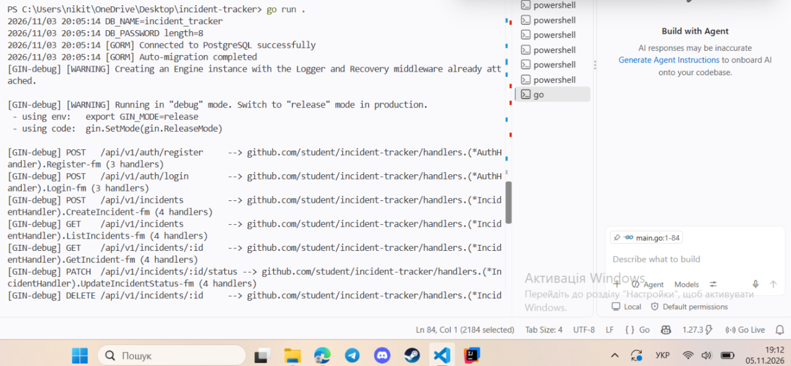
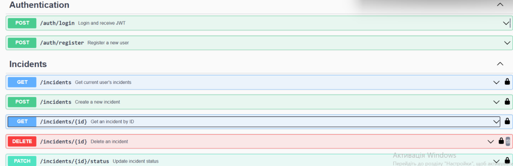
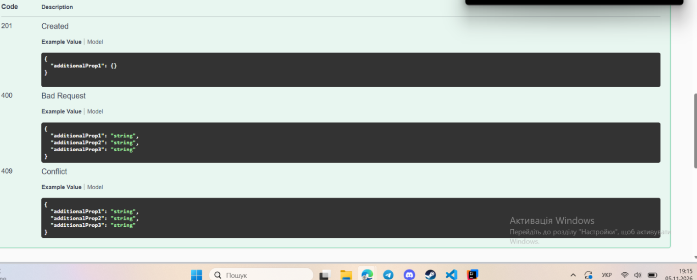
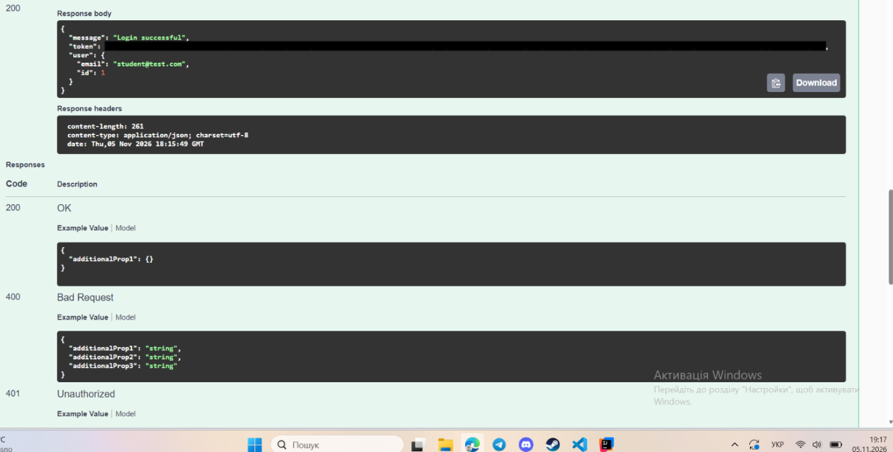
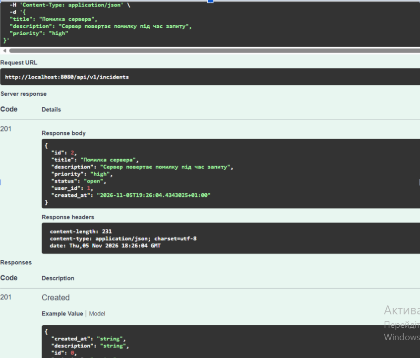
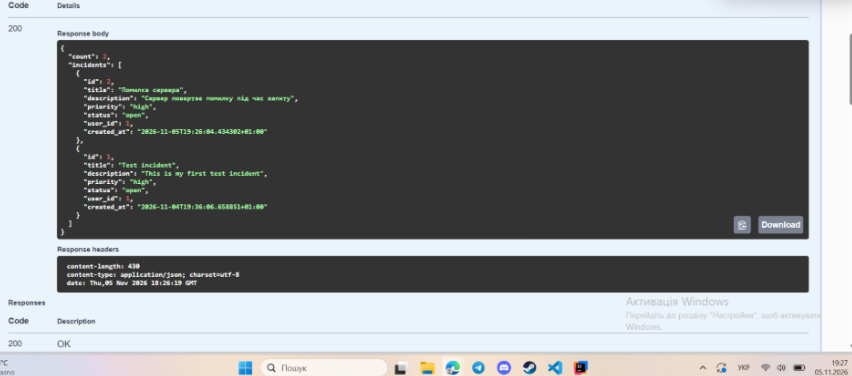
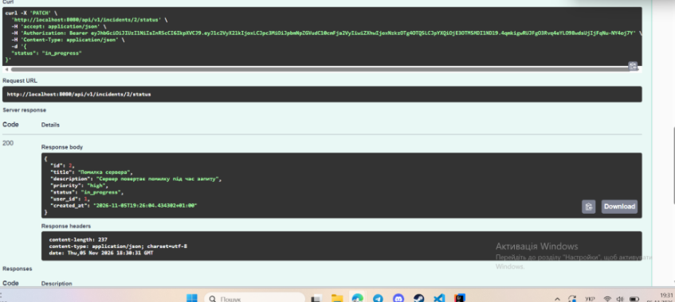
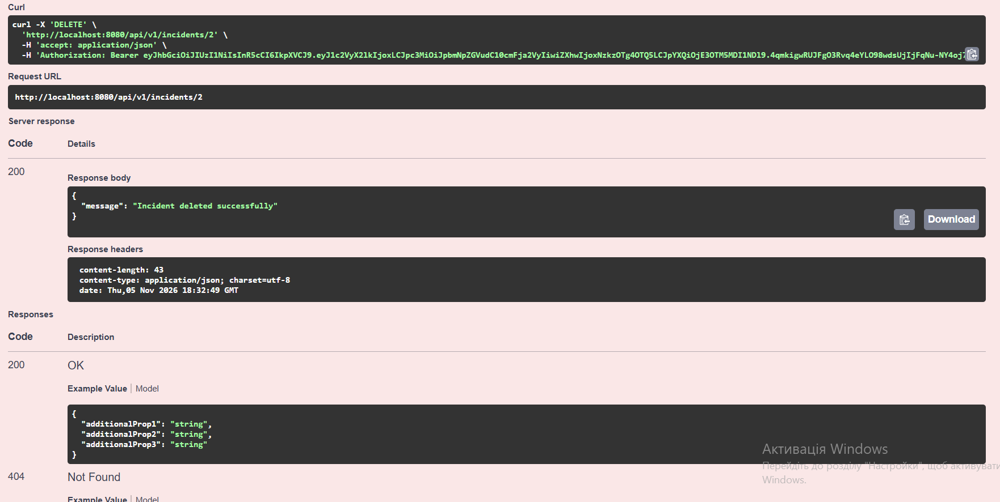
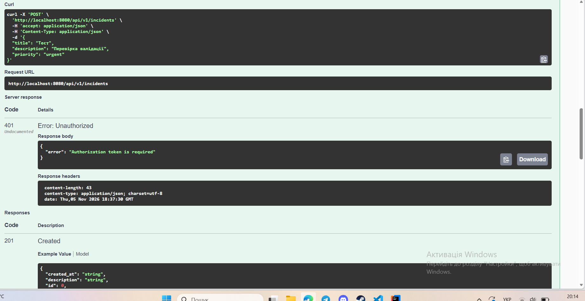

# Incident Tracker API

## Опис проєкту

**Incident Tracker API** — REST API для створення, перегляду, оновлення та видалення технічних інцидентів.

Проєкт розроблений мовою Go з використанням Gin, PostgreSQL та GORM. Для автентифікації користувачів використовуються bcrypt і JWT. Документація API доступна через Swagger UI.

## Використані технології

- Go
- Gin
- PostgreSQL
- GORM
- JWT (golang-jwt/jwt)
- bcrypt
- Swagger UI

## Реалізовані можливості

- Реєстрація користувачів.
- Авторизація користувачів.
- Хешування паролів за допомогою bcrypt.
- Генерація JWT-токенів зі строком дії 24 години.
- Захист маршрутів за допомогою JWT Middleware.
- Створення інцидентів.
- Перегляд списку інцидентів.
- Отримання інциденту за ID.
- Оновлення статусу інциденту.
- Видалення інциденту.
- Перевірка прав користувача на доступ до власних інцидентів.
- Автоматична міграція таблиць через GORM.
- Документація API через Swagger UI.

## Структура проєкту

```text
incident-tracker/
├── config/
│   └── database.go
├── docs/
├── dto/
│   └── incident.go
├── handlers/
│   ├── auth.go
│   └── incident.go
├── middleware/
│   └── jwt.go
├── models/
│   ├── incident.go
│   └── user.go
├── screenshots/
│   ├── create-incident.png
│   ├── delete-incident.png
│   ├── list-incidents.png
│   ├── login.png
│   ├── register.png
│   ├── server.png
│   ├── swagger.png
│   ├── update-status.png
│   └── validation-error.png
├── .gitattributes
├── .gitignore
├── go.mod
├── go.sum
├── main.go
└── README.md
```

## Налаштування та запуск

### 1. Необхідні компоненти

Перед запуском потрібно встановити:

- Go версії 1.22 або новішої;
- PostgreSQL;
- Git.

### 2. Клонування репозиторію

```bash
git clone https://github.com/ТВІЙ_ЛОГІН/incident-tracker.git
cd incident-tracker
```

### 3. Створення бази даних

У PostgreSQL потрібно створити базу даних:

```sql
CREATE DATABASE incident_tracker;
```

### 4. Налаштування змінних середовища

Створи файл `.env` у корені проєкту:

```env
JWT_SECRET=your_secret_key
APP_PORT=8080
```

Параметри підключення до PostgreSQL мають відповідати налаштуванням у `config/database.go`.

**Примітка:** файл `.env` не потрібно завантажувати до GitHub. Для прикладу налаштувань можна використовувати `.env.example`.

### 5. Встановлення залежностей

```bash
go mod download
```

### 6. Запуск сервера

```bash
go run .
```

Після успішного запуску API буде доступний за адресою:

```text
http://localhost:8080
```

## Swagger UI

Інтерактивна документація API доступна за адресою:

[http://localhost:8080/swagger/index.html](http://localhost:8080/swagger/index.html)

У Swagger можна переглядати ендпоінти та тестувати запити. Для захищених маршрутів потрібно використати JWT-токен через кнопку **Authorize**.

## Основні маршрути API

| Метод | Маршрут | Призначення |
|---|---|---|
| POST | `/api/v1/auth/register` | Реєстрація |
| POST | `/api/v1/auth/login` | Авторизація |
| POST | `/api/v1/incidents` | Створення інциденту |
| GET | `/api/v1/incidents` | Перегляд списку |
| GET | `/api/v1/incidents/:id` | Отримання інциденту |
| PATCH | `/api/v1/incidents/:id/status` | Оновлення статусу |
| DELETE | `/api/v1/incidents/:id` | Видалення інциденту |

## Скріншоти роботи програми

### 1. Успішний запуск сервера



### 2. Swagger UI



### 3. Реєстрація користувача



### 4. Авторизація та отримання JWT



### 5. Створення інциденту



### 6. Перегляд списку інцидентів



### 7. Оновлення статусу інциденту



### 8. Видалення інциденту



### 9. Перевірка валідації даних




## Висновок

Під час виконання практичної роботи було створено REST API для системи Incident Tracker на мові Go з використанням Gin, PostgreSQL та GORM.

Реалізовано реєстрацію й авторизацію користувачів, хешування паролів за допомогою bcrypt, генерацію JWT-токенів і middleware для захисту маршрутів. Налаштовано Swagger для документування та тестування API.

Перевірено підключення до бази даних, роботу авторизації та відхилення запитів без токена. Після завершення тестування CRUD-маршрутів перевірено основні операції зі створення, перегляду, оновлення та видалення інцидентів.
